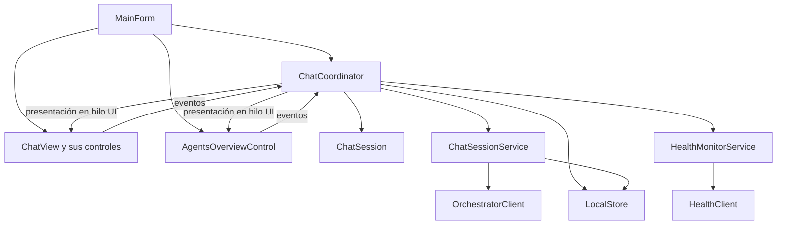

# Organización de las vistas WinForms

Agentest conserva un proyecto, una capa y una unidad de despliegue. La modularidad se organiza mediante carpetas, composición de controles y servicios concretos, sin paquetes adicionales.

## Estructura

```text
agentest/
  Forms/
    Main/             MainForm
    Chat/             ChatCoordinator
    Agents/           ProfileEditorForm
    Groups/           GroupManagerForm
    Conversations/    DeleteConversationForm
    Theming/          ThemePalette, ThemeAppearance, ThemeButton
  Controls/
    Chat/             ChatView, AgentSelectorControl, TranscriptControl,
                      MessageComposerControl
    Conversations/    ConversationSidebarControl, ConversationListBox
    Agents/           AgentsOverviewControl, SystemDiagramControl
  Models/             ChatSession y modelos del catálogo e historial
  Services/           ChatSessionService, HealthMonitorService y clientes
  Persistence/        LocalStore
```

Cada formulario y control compuesto tiene archivos `.cs`, `.Designer.cs` y `.resx`. `InitializeComponent()` configura el árbol visual; el otro archivo parcial contiene comportamiento y enlace de datos. Los controles de dibujo propio, `ConversationListBox` y `SystemDiagramControl`, mantienen el código de representación en su clase.

Los layouts siguen definidos mediante código en `InitializeComponent()`, incluyendo paneles de distribución y filas dinámicas. La separación de archivos y los constructores sin parámetros permiten trabajar con las convenciones de WinForms; la edición visual en el diseñador de Visual Studio no se ha validado en esta tarea.

## Responsabilidades

| Módulo | Responsabilidad |
| --- | --- |
| `MainForm` | Alojar pestañas, iniciar la ejecución al mostrarse y gestionar cierre y liberación del coordinador. |
| `ChatView` | Componer los controles del chat, presentar estado y menús de administración y apariencia. |
| `AgentSelectorControl` | Seleccionar sistema y agente y mostrar los agentes del sistema. |
| `ConversationSidebarControl` | Filtrar el historial por ID del agente y publicar selección, creación y eliminación solicitadas. |
| `MessageComposerControl` | Capturar el borrador, mostrar adjuntos y publicar envío, cancelación y acciones de adjuntos. |
| `TranscriptControl` | Representar mensajes, estados de entrega y metadatos de adjuntos. |
| `AgentsOverviewControl` | Presentar resúmenes y diagramas de los sistemas, sin iniciar consultas HTTP. |
| `ChatCoordinator` | Resolver acciones del usuario, confirmaciones y cambios de selección; conectar vistas y servicios y aplicar sus resultados. |
| `ChatSession` | Mantener catálogo, conversaciones cargadas, conversación actual, borrador y adjuntos pendientes en memoria. |
| `ChatSessionService` | Guardar la solicitud pendiente antes de enviar, usar el cliente HTTP, conservar el ID remoto, recuperar borradores y guardar el resultado. |
| `HealthMonitorService` | Mantener instantáneas de perfiles y credenciales de health, programar consultas, impedir rondas superpuestas y descartar resultados obsoletos. |
| `LocalStore` | Leer, guardar y eliminar datos locales; conservar la escritura temporal y el reemplazo. |

Los controles exponen eventos y operaciones de presentación. No reciben `LocalStore`, `OrchestratorClient` ni `HealthClient`. El coordinador recibe selecciones y borradores mediante esas operaciones, sin buscar controles por nombre ni manipular campos privados de las vistas.

## Flujo y ciclo de vida



1. Los constructores crean controles y conectan eventos sin leer archivos ni iniciar solicitudes.
2. Al mostrarse `MainForm`, se crea el coordinador y se cargan apariencia, catálogo e historial. Las solicitudes pendientes de una ejecución anterior se marcan como interrumpidas.
3. El estado de `ChatSession` se presenta en los controles. El texto del compositor se sincroniza con el borrador del modelo.
4. El servicio de envío notifica los cambios de estado. La vista refleja solicitud pendiente, resultado o borrador recuperado. Un fallo al guardar la solicitud inicial impide llamar al backend.
5. El monitoreo usa un temporizador asíncrono independiente de WinForms. Trabaja con instantáneas y notifica resultados; el coordinador los aplica en el hilo de interfaz mediante `BeginInvoke` cuando es necesario.
6. Al cerrar, el coordinador verifica operaciones y borradores. Cuando el cierre continúa, cancela el monitoreo, libera clientes y retira la suscripción a cambios de preferencias de Windows. Los callbacks pendientes se ignoran si la ventana ya se está cerrando.

Las credenciales viven en memoria dentro del coordinador y las instantáneas del monitor. No se serializa `ChatSession` completa: se guardan explícitamente catálogo, preferencias y conversaciones mediante `LocalStore`. La refactorización conserva las rutas y los formatos de los archivos locales y los contratos HTTP.

## Verificación

El script `scripts/Verify.ps1` referencia los nuevos namespaces. Además de los flujos del usuario, verifica construcción de vistas sin acceso a disco, envío desde el compositor, cancelación y recuperación de borrador en el servicio, fallos de persistencia, rondas de health sin superposición, intervalos y descarte de resultados de perfiles reemplazados. Las consultas se simulan; la conexión real a cada backend se verifica por separado.
